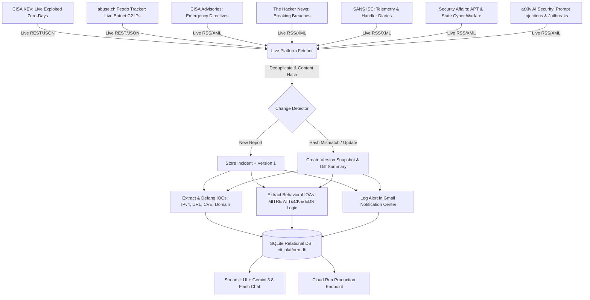

# Walkthrough: SOC Swarm CTI - Live Multi-Platform Intelligence, IOA Extraction & Cloud Deployment

**SOC Swarm CTI** is an autonomous multi-agent Cyber Threat Intelligence (CTI) and breach investigation application powered by **Gemini 3.8 Flash**, **Vertex AI text-embedding-004**, **SQLite**, **Streamlit**, **FastAPI**, and **React + Vite**.

This milestone delivers live real-time ingestion across 7 threat intelligence platforms (government catalogs, live botnet trackers, and research feeds), multi-version change detection (`report_versions`), behavioral Indicators of Attack (IOA), and deployment to **Google Cloud Run**.

---

## 1. Multi-Platform Live Ingestion Architecture



---

## 2. Integrated Live Threat Intelligence Platforms

1. **CISA Known Exploited Vulnerabilities (KEV)**:
   - Official US Cybersecurity and Infrastructure Security Agency catalog of actively exploited CVE zero-days.
   - Extracts: CVE ID, vendor, product, date added, remediation required, and `T1190` exploit attack patterns.
2. **abuse.ch Feodo Tracker**:
   - Real-time botnet command-and-control (C2) server IP addresses and port telemetry (Emotet, QakBot, Dridex).
   - Extracts: Safe defanged IPv4 IOCs (`162[.]243[.]103[.]246:8080`), port numbers, malware families, and C2 beaconing IOAs (`T1071.001`).
3. **CISA Cybersecurity Advisories**:
   - National emergency directives and industrial control systems (ICS) advisories.
4. **The Hacker News (THN)**:
   - Global cyber breach reporting, ransomware campaigns, and zero-day disclosures.
5. **SANS Internet Storm Center (ISC)**:
   - Real-time global threat levels, port scanning activity, and daily handler analysis diaries.
6. **Security Affairs**:
   - Nation-state cyber warfare, APT espionage, and critical infrastructure attacks.
7. **arXiv AI Security (cs.CR)**:
   - Academic and industry disclosures on LLM prompt injections, jailbreaks, malicious MCP server tools, and autonomous agent hijacking (`T1059.006`).

---

## 3. Mandatory Feature Verification

### 1. Incident Versioning & Meaningful Update Detection (Feature #7)
- SHA-256 content hashes are calculated for every incoming report.
- When an advisory is updated on the source platform:
  - Preserves previous versions in `report_versions` table (`version_number = 1, 2, ...`).
  - Records diff summary and analyst change notes.
  - Updates incident flag to `is_updated = 1` and displays badge `🔔 UPDATED (v2)` in UI.
  - Emits an `[SOC SWARM][REPORT UPDATE]` notification.

### 2. Daily Threat Intelligence Newsletters & Deduplication
- **Cross-Source Deduplication**: Normalizes stories across multiple outlets reporting on the same breach or CVE, ensuring only unique incidents are cataloged.
- **Executive Daily Digest**: Synthesized with Gemini 3.8 Flash, featuring:
  - 🛡️ Executive Strategic Briefing
  - 🚨 Critical CVEs & Zero-Day Exploitations
  - 🤖 AI Security & Adversarial Threat Watch
  - 🦠 Active Botnet Infrastructure & Network IOCs
  - ⚔️ Behavioral IOAs & MITRE ATT&CK Recommendations
  - 📋 Index of Unique Verified Disclosures for the Day
- **Historical Time-Travel Archive**: Date picker allowing security analysts to select any previous calendar date (`2026-10-13`, `2026-10-12`, `2026-10-11`, etc.) to view past briefings and reports.
- **One-Click Markdown Download**: Analysts can export the complete daily newsletter for executive briefings.

### 3. Behavioral IOA Extraction
- Extracts adversary tactics, techniques, and procedures (TTPs) mapped to **MITRE ATT&CK**.
- Generates concrete detection logic (Sigma rules, EDR queries, Suricata signatures).
- Exportable to CSV via one click in the **IOA Explorer** tab.

### 4. Defensive IOC Normalization & Defanging
- Defangs IPv4, IPv6, URLs, domains, and emails (`[.]`, `hxxp://`).
- Exportable to CSV via one click in the **IOC Explorer** tab.

### 5. Gemini 3.8 Flash Threat Intelligence Chat
- Grounded in local SQLite store and live telemetry.
- Exact database lookup for IP, domain, hash, or CVE queries.
- Clear separation between stored database findings and live synthesized intelligence.

### 6. Autonomous SIEM & EDR Rule Synthesizer
- Generates production-ready detection logic across 6 enterprise standards:
  - **Sigma Rule (YAML)**: EDR detection rule mapped to MITRE ATT&CK technique IDs.
  - **Splunk SPL**: Ready-to-execute search syntax for firewall, proxy, and EDR indexes.
  - **Elasticsearch KQL**: Query for Elastic Defend and Kibana SIEM.
  - **Suricata / Snort**: Network intrusion signature for active botnet C2 traffic.
  - **AWS WAF / Cloudflare**: IP set blocklist JSON for boundary protection.
  - **YARA**: File and host memory pattern signature.

### 7. Tech Stack Watchdog & Impact Matcher
- Evaluates threat reports against the organization's monitored infrastructure (Linux, Kubernetes, Docker, Windows Server, Apache, Nginx, PostgreSQL, AWS, Palo Alto, Cisco, Fortinet, etc.).
- Categorizes exposure level (`CRITICAL_EXPOSURE`, `HIGH_EXPOSURE`) and synthesizes an automated emergency remediation runbook.

### 8. STIX 2.1 & TAXII 2.1 Compliance
- Implements Oasis STIX 2.1 JSON bundle standard (`bundle`, `identity`, `indicator`, `attack-pattern`, `report`).
- Exposes direct endpoint `/api/stix2/bundle` and one-click JSON download for enterprise SIEM ingestion.

### 9. ChatOps & Slack Dispatcher
- Formats rich Slack Block-Kit messages with buttons (`[🛡️ View in Dashboard]`, `[📋 Copy Sigma Rule]`) and posts to `#soc-threat-intel`.

---

## 4. Deployment Verification

### 1. Local Streamlit MVP
- URL: [http://localhost:8501](http://localhost:8501)
- HTTP Status: `200 OK`
- Navigation: Daily Threat Intel Digest, Executive Dashboard, SIEM & EDR Rule Synthesizer, Tech Stack Watchdog, STIX 2.1 Exporter, ChatOps Dispatcher, Live Ingestion, Feed, IOC Explorer, IOA Explorer, Chat, Settings.

### 2. Google Cloud Run (Production)
- Service: `soc-swarm-cti`
- Current Revision: `soc-swarm-cti-00004-sfd`
- Production URL: [https://soc-swarm-cti-235215015655.asia-south2.run.app](https://soc-swarm-cti-235215015655.asia-south2.run.app)
- Traffic: 100% routed
- HTTP Verification:
  ```bash
  curl -s -I https://soc-swarm-cti-235215015655.asia-south2.run.app
  HTTP/2 200
  ```

### 3. GitHub Source Code Repository
- Public URL: [https://github.com/sarthi-parth/buildwithgemini-soc-swarm-cti](https://github.com/sarthi-parth/buildwithgemini-soc-swarm-cti)
- Pushed Commit: `76840ed` (*feat: add SIEM/EDR rule synthesizer, STIX 2.1 exporter, tech stack watchdog runbooks, and Slack ChatOps*)

### 4. Automated Test Suite
- Test Runner: `pytest` (**14/14 tests passed**)
  - `test_rule_generator`: Passed
  - `test_stix_bundle_generation`: Passed
  - `test_asset_matcher`: Passed
  - `test_slack_webhook_payload`: Passed
  - `test_defang_val`: Passed
  - `test_title_similarity_deduplication`: Passed
  - `test_newsletter_generation_flow`: Passed
  - `test_ioc_format_validation`: Passed
  - `test_ioc_defanging`: Passed
  - `test_source_url_normalization`: Passed
  - `test_deterministic_ioc_extraction`: Passed
  - `test_email_payload_generation`: Passed
  - `test_prompt_injection_sanitization_in_iocs`: Passed
  - `test_email_recipient_tamper_defense`: Passed
